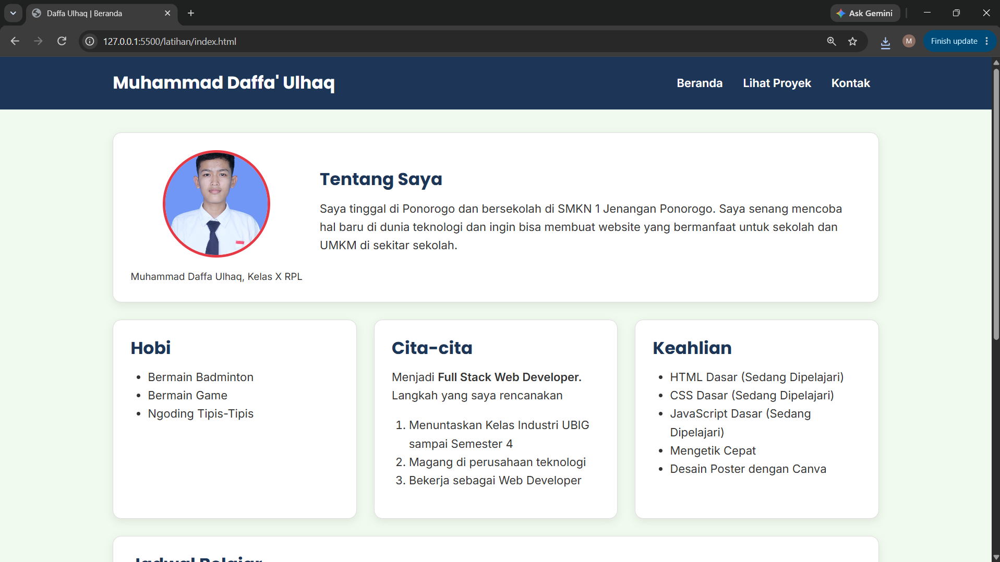

# Portofolio 

website portofolio pribadi yang saya buat di Kelas Industri UBIG
(Paket 1, Minggu 01 Sampai 05).
Website ini tampil rapi di ponsel, tablet, dan laptop.

## Tampilan

## Fitur

- Halaman **Beranda** berisi Profil, Hobi, Cita-Cita, Keahlian, dan Jadwal Belajar
Jadwal Belajar
- Halaman **Proyek** berisi Daftar Proyek Dalam Bentuk Kartu
- Halaman **Kontak** berisi Form untuk Menghubungi Saya
- Tampilan responsif dengan Flexbox dan *media query*

## Teknologi

- HTML5
- CSS3 (Flexbox dan media query)
- Git dan GitHub

## Tautan

- Website: Menyusul setelah *deploy* ke Vercel
- Dibuat oleh: Muhammad Daffa' Ulhaq, SMKN 1 Jenangan